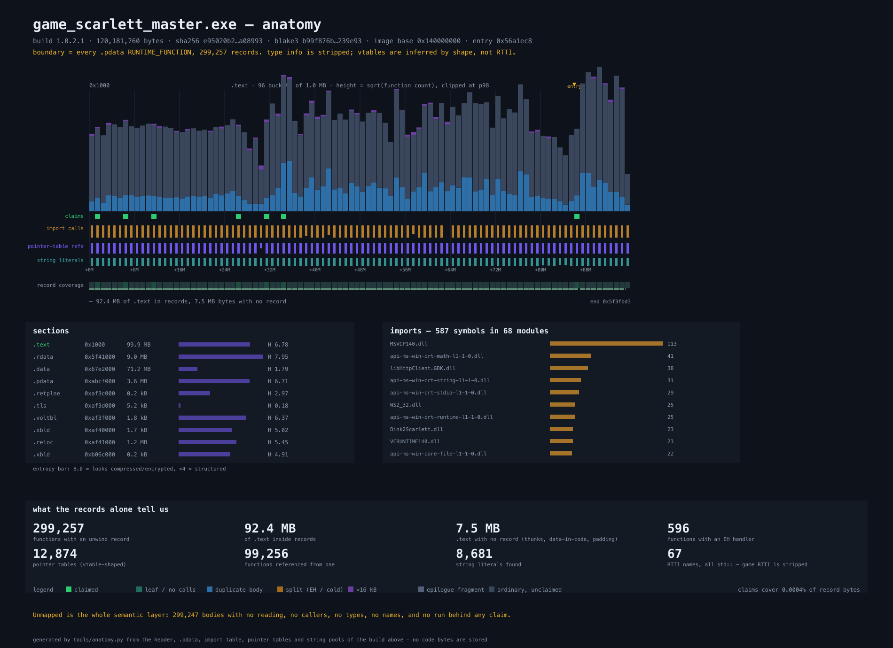

# The executable, and the job



[SVG](img/exe-anatomy.svg) · regenerate with `tools/anatomy.py` (see the bottom of
this file). Everything below is derived from headers, `.pdata`, the import
table, pointer tables and the string pools of build 1.0.2.1. No code bytes are
stored.

## What the picture shows

The strip is `.text`, 99.9 MB in 96 buckets of 1 MB. Height is function count,
square-rooted and clipped at the 98th percentile so outliers do not flatten the
rest. Colour is the scanner's class. Four rows underneath are signals, not
classes: claims (green), import calls (amber), functions referenced from
pointer tables (violet), functions referencing a string literal (teal). The
ribbon below is the fraction of each bucket covered by any `.pdata` record.

Shape, without interpretation:

* **Two dense clusters** around +32 to +40 MB and +74 to +84 MB. The second is
  the largest and runs straight through the entry point at +86.8 MB, where the
  9,973-function tail of the section is.
* **A visible hole at about +28 MB**: one bucket with almost no records.
* **Coverage is dense but not complete**: 92.4 MB of 99.9 MB is inside a
  record, and 7.5 MB is not — thunks, data-in-code, alignment, and cold blocks
  that never unwound.
* **Import calls are uniform** across the whole section; this is not a binary
  where I/O is confined to a corner.
* **String literals are denser toward the low addresses** (+0 to +30 MB) and in
  the entry cluster. Those are the naming-rich regions.
* **Pointer-table references** are everywhere; 99,256 functions are named by at
  least one table, which is a third of the binary.
* **Claims are ten dots.** At this zoom they are noise, which is honest.

## What the picture does *not* show, and cannot

1. **Types.** RTTI is stripped: the only 209 type names are `std::`'s own. There
   are no class names, no hierarchy, no member layouts. Every struct is
   hand-derived from reads and writes.
2. **Callers.** The graphic counts import calls, not intra-binary calls. The
   call graph is still unbuilt, so a function's role cannot be inferred from who
   calls it.
3. **Exception structure.** Only 596 functions carry an EH handler, and the
   handler bodies are separate records — the cold blocks inside the dense
   clusters are partly EH funclets, indistinguishable from code at this zoom.
4. **Semantics.** Zero of the 299,257 bodies have a confirmed behaviour. Ten
   have a reading; none has a run behind it.
5. **The 220 GB around it.** `.data` is 71.2 MB and looks structured (entropy
   1.79) — that is where the globals, the four registration pointers and most
   of the vtables live. `.rdata` is 9.0 MB at entropy 7.95, high because of the
   pointer tables it carries, but its literals are plain: 72,093 readable
   strings sit in it.

## The job, mapped

Four phases. Each has an entry condition and an exit gate; nothing advances on
vibes.

| Phase | Work | Entry | Exit gate |
|---|---|---|---|
| **P0 — shape** (done) | map, classes, queue, claims, check, automerge, legal ladder | fork of VIctory exists | map reproducible, bot merges a `decomp/`-only PR unattended |
| **P1 — loop** (current) | toolchain, compiler pins, `revi diff`, oracle harness, 50 leaves | P0 | 50 bodies, three replaying runs each, diff and oracle agree |
| **P2 — structure** | strings, pointer tables, frame/type reconstruction, EH templates, call graph | P1 | one subsystem (files/allocator) links and a session survives it |
| **P3 — rebuild** | objects link against the shims, no `.text` from the exe | P2 | the title runs from our objects with the original section absent |

Work is distributed by RVA: one claim, one file set, no shared index. The
scanner decides what is cheap, not a human.

### The queue, as of the map

| Class | Count | Treatment |
|---|---:|---|
| ordinary, unclaimed | 266,040 | the long tail, ranked |
| duplicate body | 25,329 | decompile the twin, claim as alias |
| epilogue fragment | 25,914 | rank low, merge target |
| split body (EH/cold) | 3,204 | claim with `--chunks`, lower score |
| > 16 kB | 84 | recognise patterns (dispatch tables), generate |
| claimed / ported | 10 | 2 identical modulo relocations |

### Known unknowns, ranked by damage

1. **Compilation toolset.** The retail minor is unknown. Two 23-byte functions
   differ only in encoding and spill slot, which points at the version, not the
   source. Resolve before P1's 50 are called done.
2. **No oracle.** Everything stops at `ported` until the package lands and a
   WARP run can record vectors.
3. **The 7.5 MB without records.** Some is junk, some is real leaf code reached
   only by jump. Needs a linear sweep to separate.
4. **`.rdata` at H 7.95.** Resolved: not compressed, literals are plain
   (`decomp/map/strings.csv`). The entropy is pointer tables, not encoding.

### Non-goals

Byte-identical rebuild as a gate; the CRT; third-party middleware beyond
identification; assets; script bytecode; the renderer before the loader runs
our code.

## Regenerating

```sh
revi map <exe> --out /tmp/functions.csv
revi scan <exe> --out /tmp/candidates.csv --queue /tmp/q.md
python3 tools/anatomy.py <exe> /tmp/functions.csv /tmp/candidates.csv /tmp/anatomy.json
```

The first two need the exe; the renderer needs `rsvg-convert` and takes the JSON
only, so a contributor can regenerate the picture from numbers alone.
